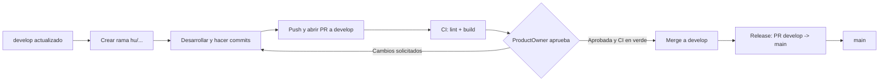

# Repositorio FIS

Repositorio compartido de los grupos de **Fundamentos de Ingeniería de Software** para la plataforma de gestión de una escuela de patinaje de velocidad. Reúne los requisitos, el design system, los wireframes y el código de la aplicación.

| Rama | Propósito |
| ---- | --------- |
| `main` | Versión estable. Solo recibe merges desde `develop` o `hotfix/*`. |
| `develop` | Rama de integración. Recibe las historias de usuario mediante Pull Request. |

> Si `develop` todavía no existe en el remoto, créala una sola vez desde `main`:
>
> ```bash
> git checkout main
> git pull origin main
> git checkout -b develop
> git push -u origin develop
> ```

---

## Contenido del repositorio

```text
.
├── .agents/skills/              # Skills e instrucciones para agentes de IA
├── .github/
│   ├── pull_request_template.md # Plantilla por defecto para PR mixtas
│   ├── workflows/               # Pipelines de CI (frontend.yml, backend.yml)
│   └── PULL_REQUEST_TEMPLATE/   # Plantillas de PR para frontend y backend
├── code/
│   ├── backend/                 # API NestJS + TypeScript (pnpm)
│   └── frontend/                # React + TypeScript + Vite (pnpm)
├── design-system/               # Tokens, componentes y pruebas del design system
├── docs/                        # Contexto, requisitos, specs y changelog
├── wireframes/                  # Prototipos por grupo
└── README.MD
```

- **`code/backend/`**: API construida con NestJS. Se administra con pnpm.
- **`code/frontend/`**: aplicación React con Vite y TypeScript. Se administra con pnpm.
- **`design-system/`**: tokens y componentes compartidos. La guía de uso está en `docs/EXPLANATION.md`.
- **`docs/`**: `CONTEXT.md` (contexto y reglas de negocio), `REQUIREMENTS.md` (trazabilidad de requisitos), `specs/` (especificaciones) y `CHANGELOG.md`.
- **`wireframes/`**: una carpeta por grupo (`grupo-01`, `grupo-03`, …).
- **`.agents/`**: skills para que los agentes de IA sigan las convenciones del proyecto.

---

## Requisitos previos

- Git
- Node.js 22.12 o superior
- pnpm 10 o superior

## Puesta en marcha

### Backend

```bash
cd code/backend
pnpm install
pnpm start:dev
```

Comandos útiles:

```bash
pnpm lint
pnpm build
pnpm test
pnpm test:e2e
```

### Frontend

```bash
cd code/frontend
pnpm install
pnpm dev
```

Comandos útiles:

```bash
pnpm lint
pnpm build
pnpm preview
```

---

## Flujo de desarrollo

El trabajo se organiza por **historias de usuario (HU)**. Cada HU se desarrolla en una rama propia y se integra a `develop` mediante una Pull Request revisada por el equipo de Product Owners.



1. Actualiza `develop`:

   ```bash
   git checkout develop
   git pull origin develop
   ```

2. Crea una rama para la HU:

   ```bash
   git checkout -b hu/HU-M1-01-registro-usuario
   ```

3. Desarrolla el cambio y haz commits pequeños siguiendo la [nomenclatura de commits](#commits).
4. Sube la rama y abre una Pull Request hacia `develop` usando la plantilla de frontend o de backend.
5. Espera a que el pipeline de CI termine en verde.
6. Solicita revisión a un integrante del equipo de Product Owners.
7. Corrige los comentarios, vuelve a subir los cambios y espera la aprobación.
8. Haz merge a `develop` y borra la rama.
9. Cuando `develop` esté estable, abre una PR de `develop` hacia `main` para publicar una versión.

> Los cambios urgentes sobre producción se hacen en una rama `hotfix/*` creada desde `main`, se integran a `main` mediante PR y luego se llevan de vuelta a `develop`.

### Ramas

| Tipo | Formato | Se crea desde | PR hacia | Ejemplo |
| ---- | ------- | ------------- | -------- | ------- |
| Historia de usuario | `hu/<HU-id>-<descripcion>` | `develop` | `develop` | `hu/HU-M1-01-registro-usuario` |
| Corrección | `fix/<descripcion>` | `develop` | `develop` | `fix/validacion-cartera-vencida` |
| Documentación | `docs/<descripcion>` | `develop` | `develop` | `docs/reglas-ramas-commits` |
| CI e infraestructura | `ci/<descripcion>` | `develop` | `develop` | `ci/pipelines-frontend-backend` |
| Urgencia en producción | `hotfix/<descripcion>` | `main` | `main` | `hotfix/enlaces-rotos-inicio` |

Reglas:

- Una rama por historia de usuario o tarea. No mezclar varias HU en una misma rama.
- El ID de la HU se escribe tal como está en el backlog (`HU-M1-01`); la descripción va en minúsculas, sin tildes, sin `ñ` y sin espacios. Usa guiones para separar palabras.
- No trabajar directamente sobre `main` ni sobre `develop`.
- Las ramas existentes que no siguen este formato se consideran legadas: no se renombran si ya están en revisión, pero las ramas nuevas deben seguir la tabla.
- Después del merge, elimina la rama.

### Commits

Se usa el formato de **Conventional Commits**:

```text
<tipo>(<alcance>): <descripción>
```

El alcance es opcional. La descripción va en español, en imperativo, sin punto final y con máximo 72 caracteres.

| Tipo | Cuándo usarlo |
| ---- | ------------- |
| `feat` | Nueva funcionalidad |
| `fix` | Corrección de un error |
| `docs` | Cambios en documentación |
| `style` | Formato o estilo sin cambio de lógica |
| `refactor` | Reestructuración sin cambio funcional |
| `perf` | Mejora de rendimiento |
| `test` | Pruebas nuevas o corregidas |
| `build` | Build o dependencias |
| `ci` | Pipelines y configuración de integración continua |
| `chore` | Mantenimiento general |
| `revert` | Revertir un commit anterior |

Alcances sugeridos: `frontend`, `backend`, `docs`, `wireframes`, `design-system`, `ci`.

Ejemplos:

```text
feat(frontend): agregar formulario de inicio de sesión
fix(backend): impedir inscripción con cartera vencida
docs(repo): documentar flujo de ramas y commits
ci: agregar pipelines de lint y build
refactor(backend): extraer validación de póliza
test(frontend): cubrir estados del formulario de acceso
chore(frontend): actualizar dependencias
```

Reglas:

- Commits pequeños y frecuentes: un cambio coherente por commit.
- No mezclar cambios de frontend y backend en el mismo commit si se pueden separar.
- Si el commit necesita contexto, agrega un cuerpo después de una línea en blanco y explica **por qué**, no qué.
- Referencia la HU o el requisito en el pie del commit:

```text
feat(backend): validar cartera vencida en inscripción

La inscripción se rechaza cuando el patinador tiene cartera vencida,
según RF-M4-08.

Refs: HU-M4-06, RF-M4-08
```

- Para cambios incompatibles, usa `!` después del tipo o del alcance (`feat(api)!: ...`) y explica el cambio en el cuerpo.
- Evita mensajes como `cambios`, `asdf`, `final`, `final2`, `wip` o `add`.

### Pull Requests

- La PR debe apuntar a `develop`, salvo las PR de release (`develop` → `main`) y los `hotfix/*` (`hotfix/*` → `main`).
- El título debe seguir el mismo formato que un commit, por ejemplo `feat(frontend): agregar formulario de inicio de sesión`.
- Usa la plantilla según el frente del cambio:
  - PR mixta (frontend + backend): [`.github/pull_request_template.md`](.github/pull_request_template.md), que se carga por defecto.
  - Solo frontend: [`.github/PULL_REQUEST_TEMPLATE/frontend.md`](.github/PULL_REQUEST_TEMPLATE/frontend.md). Al crear la PR, agrega `?template=frontend.md` a la URL de comparación.
  - Solo backend: [`.github/PULL_REQUEST_TEMPLATE/backend.md`](.github/PULL_REQUEST_TEMPLATE/backend.md). Al crear la PR, agrega `?template=backend.md` a la URL de comparación.
- Si usas la plantilla por defecto, completa solo las secciones de los frentes que modificaste.
- Los dos pipelines se ejecutan siempre, aunque la PR solo modifique uno de los frentes.
- La PR debe ser revisada y aprobada por al menos una persona del equipo de Product Owners.
- No hacer merge con el CI en rojo, con conflictos sin resolver o sin la aprobación requerida.
- No hacer merge de una PR propia sin revisión.
- Después del merge, elimina la rama.

---

## Integración continua

Cada Pull Request hacia `develop` o `main` ejecuta automáticamente dos pipelines de GitHub Actions:

| Pipeline | Archivo | Directorio | Qué valida |
| -------- | ------- | ---------- | ---------- |
| Frontend CI | `.github/workflows/frontend.yml` | `code/frontend` | `pnpm lint` y `pnpm build` |
| Backend CI | `.github/workflows/backend.yml` | `code/backend` | `pnpm lint` y `pnpm build` |

Los dos pipelines se ejecutan siempre, aunque la PR solo modifique uno de los frentes. Lo que cambia es el directorio en el que corre cada uno.

Para reproducir la validación en local:

```bash
# Frontend
cd code/frontend
pnpm install --frozen-lockfile
pnpm lint
pnpm build

# Backend
cd code/backend
pnpm install --frozen-lockfile
pnpm lint
pnpm build
```

Configuración recomendada en GitHub:

- Proteger `develop` y `main`.
- Exigir los checks `Frontend CI / Lint y build` y `Backend CI / Lint y build` antes del merge.
- Exigir al menos una aprobación del equipo de Product Owners.

---

## Wireframes

Los wireframes son la propuesta de diseño de cada grupo y se construyen con el design system compartido.

- Cada grupo trabaja **solo dentro de su carpeta** `wireframes/grupo-XX/`.
- Dentro de su carpeta, una subcarpeta por página.
- Usar nombres en minúsculas, sin tildes, sin `ñ` y sin espacios; separar con guiones (`registro-tiempos/`, `perfil-acudiente/`).
- Cada grupo incluye un `README.md` con la herramienta usada, las decisiones de diseño y las brechas encontradas.
- No versionar archivos con nombres como `inicio_final_v3_ahora_si.png`; para eso está Git.
- Para abrir los prototipos que usan módulos ES, sirve el repositorio por HTTP desde la raíz:

```bash
python3 -m http.server 8000
# http://localhost:8000/wireframes/grupo-01/
```

Grupos con wireframes en el repositorio:

| Grupo | Carpeta | Módulo |
| ----- | ------- | ------ |
| Grupo 01 | `wireframes/grupo-01/` | M1 · Usuarios y Acceso |
| Grupo 02 | `wireframes/grupo-01/` | M3 · Grupos, Horarios y programación |
| Grupo 03 | `wireframes/grupo-03/` | M2 · Gestión deportiva de patinadores |
| Grupo 04 | `wireframes/grupo-04/` | M5 · Planes, Tarifas y Pagos |
| Grupo 05 | `wireframes/grupo-05/` | M4 · Competencias y Resultados |
| Grupo 06 | `wireframes/grupo-06/` | M6 · Administración, Reportes, Finanzas e Inventario |

> La numeración de los grupos no coincide con la numeración de los módulos. Las carpetas se agregan cuando el grupo publica su propuesta.

---

## Qué no subir

- Archivos temporales o del sistema (`.DS_Store`, `Thumbs.db`, `~$archivo`).
- Dependencias y builds (`node_modules/`, `dist/`, `build/`).
- Archivos pesados (videos, imágenes sin comprimir de varios MB).
- Variables de entorno, credenciales o información personal.

El `.gitignore` de la raíz ya cubre la mayoría de estos casos. Aun así, revisa `git status` antes de hacer commit.

---

## Documentación

- [`docs/CONTEXT.md`](docs/CONTEXT.md): contexto del proyecto, actores, módulos y reglas de negocio.
- [`docs/REQUIREMENTS.md`](docs/REQUIREMENTS.md): trazabilidad de requisitos funcionales.
- [`docs/specs/`](docs/specs/): especificaciones por módulo y del design system.
- [`docs/EXPLANATION.md`](docs/EXPLANATION.md): guía para construir wireframes con el design system.
- [`docs/CHANGELOG.md`](docs/CHANGELOG.md): cambios del design system.
